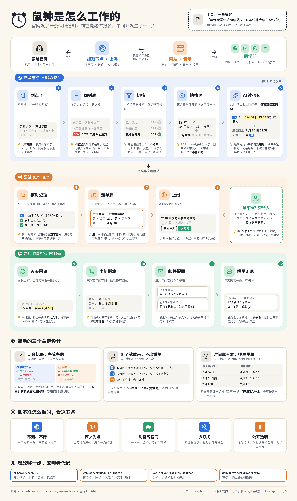

# 鼠钟

自动收集各高校学院官网的保研通知（冬令营、夏令营、预推免、九推），整理出截止时间和要点，快到了提醒你。用[鼠洞](https://bbs.mousebaoyan.cn)的账号登录。

> 还在开发中，没有上线。想法和讨论见鼠洞的[征集意见帖](https://bbs.mousebaoyan.cn/t/6771)。

## 怎么工作

跟着一条通知走一遍：抓取节点发现、初筛、读出截止时间，网站核对、整理成项目，之后盯着变化、按时提醒。细节见[总体设计](docs/design.md)。



## 设计文档

| 文档 | 内容 |
| --- | --- |
| [总体设计](docs/design.md) | 目标、已定决策、架构、技术选型、账号与权限、抓取、判别与抽取、内容、页面、提醒、纠错与审核、Agent 接入、性能、安全、部署、路线图 |
| [数据表](docs/data-model.md) | 表和关键字段、热点查询 |
| [接口](docs/api.md) | 接口约定和清单、鼠洞登录、MCP、抓取节点 |
| [开发约定](docs/development.md) | 模块划分、抓取和判别的写法、时间、日志、测试、术语 |

## 本地 Docker 预览

使用 Docker Compose 同时启动网站和 PostgreSQL，无需在宿主机安装 Node。Windows 可在 WSL 的 Ubuntu 中运行以下命令：

```sh
cd web
docker compose -f compose.yaml -f compose.preview.yaml up -d --build --wait
# 仅首次运行、数据库为空时填入示例数据：
docker compose -f compose.yaml -f compose.preview.yaml exec web pnpm seed
```

访问 `http://localhost:5173/colleges`，点击「登录」后选择假用户「鼠鼠」。示例数据均为虚构；该配置用于本机开发预览。镜像使用 DaoCloud 缓存，依赖使用 npmmirror，数据库保存在 Docker 卷中。

环境配置、依赖、构建缓存、日志和测试报告不提交；本地导出数据、截图及临时文件放在 `.local/`，由 Git 忽略。模拟账号和示例数据脚本随代码保留，运行生成的数据库记录留在 Docker 命名卷中。

停止预览并保留数据：

```sh
docker compose -f compose.yaml -f compose.preview.yaml down
```

## 参与开发

欢迎一起做。怎么认领任务、提交 PR 见 [CONTRIBUTING.md](CONTRIBUTING.md)；开发的规矩和文档索引见 [AGENTS.md](AGENTS.md)，人和编码 agent 都适用。

## 相关项目

- [鼠洞](https://github.com/mousebaoyan/mousehole)：四非计算机保研鼠群的论坛，鼠钟用它的账号
- [鼠洞的 bot 插件](https://github.com/mousebaoyan/astrbot_plugin_mousehole)

## 许可证

[MIT](LICENSE)
